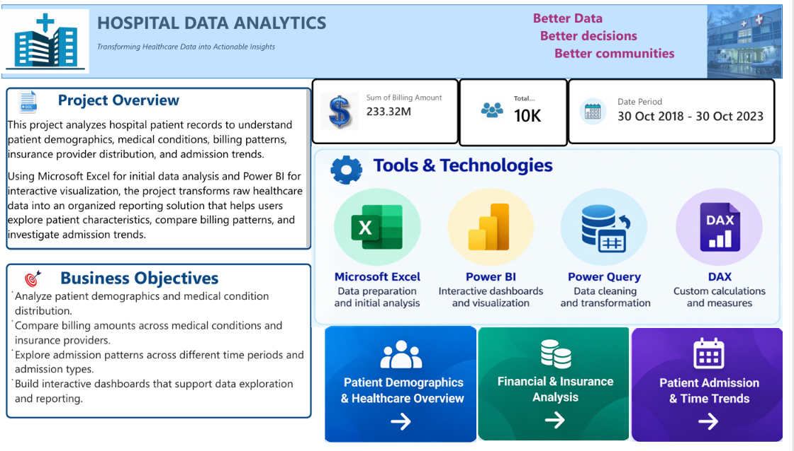
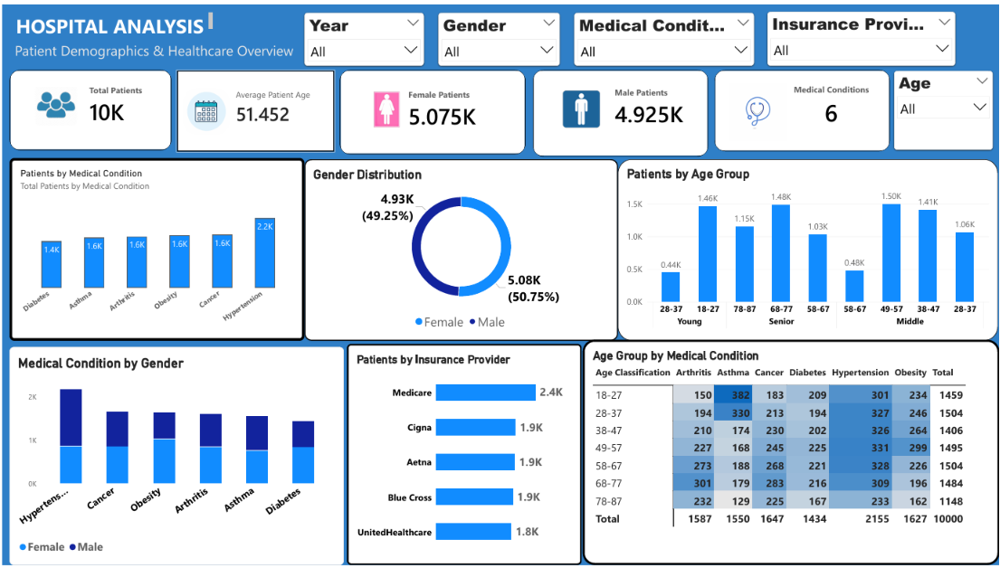
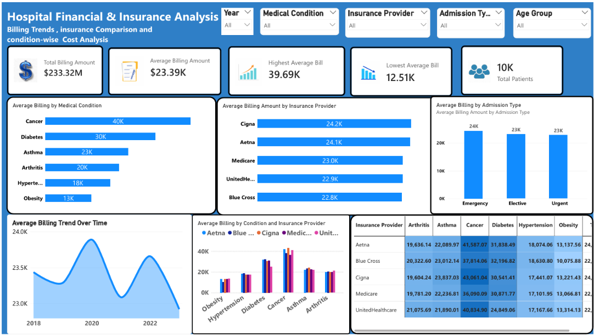
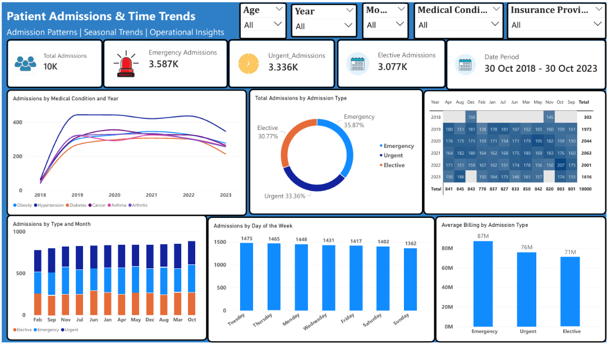
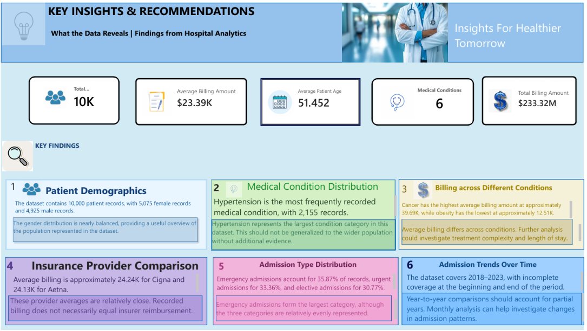

# 🏥 Hospital Data Analysis | Excel & Power BI

An end-to-end data analytics project exploring hospital admissions, patient demographics, medical conditions, billing patterns, insurance providers, and admission trends using **Microsoft Excel and Power BI**.

The project analyses 10,000 hospital admission records to uncover meaningful patterns in patient demographics, healthcare costs, and hospital operations, translating raw data into actionable insights through data cleaning, exploratory analysis, PivotTables, visualizations, and an interactive Power BI dashboard.

---

## 📌 Table of Contents

- [Project Overview](#-project-overview)
- [Why I Chose This Project](#-why-i-chose-this-project)
- [Project Objectives](#-project-objectives)
- [Tools and Technologies](#-tools-and-technologies)
- [Dataset Description](#-dataset-description)
- [Data Cleaning and Preparation](#-data-cleaning-and-preparation)
- [Exploratory Data Analysis](#-exploratory-data-analysis)
- [Business Questions Answered](#-business-questions-answered)
- [Key Insights and Findings](#-key-insights-and-findings)
- [Dashboard Preview](#-dashboard-preview)
- [Final Conclusions](#-final-conclusions)
- [Project Structure](#-project-structure)
- [How to Explore This Project](#-how-to-explore-this-project)
- [Skills Demonstrated](#-skills-demonstrated)

---

## 📖 Project Overview

Healthcare organizations generate large amounts of data through patient admissions, medical records, billing transactions, and insurance information.

However, raw data alone does not provide meaningful insights. It needs to be cleaned, organized, analysed, and visualized to support better decision-making.

In this project, I analysed a hospital dataset containing **10,000 patient admission records** to understand:

- Patient demographics and distribution of medical conditions.
- Relationships between medical conditions, age groups, and gender.
- Average hospital billing across different insurance providers.
- Billing variations across medical conditions and insurance providers.
- Admission trends across years, months, and days of the month.
- Potential opportunities to improve admission scheduling and resource planning.

The analysis was performed using Microsoft Excel, followed by the development of an interactive Power BI dashboard to present the findings.

## 💡 Why I Chose This Project

I chose hospital data analysis because healthcare is a domain where data-driven decisions can have a meaningful operational impact.

Hospitals need to understand patient demographics, admission patterns, medical conditions, and billing trends to manage their resources effectively.

I wanted to work on a project that would allow me to apply practical data analytics concepts to a real-world business domain rather than simply perform calculations on a dataset.

This project gave me an opportunity to:

- Work with a relatively large dataset containing 10,000 records.
- Practise data cleaning and handling inconsistent values.
- Apply Excel functions, PivotTables, and data visualization techniques.
- Perform demographic, financial, and time-based analysis.
- Build an interactive dashboard in Power BI.
- Convert analytical findings into business-oriented insights and recommendations.

## 🎯 Project Objectives

1. **Patient Demographic Analysis:** Understand the distribution of patients based on age and gender.

2. **Medical Condition Analysis:** Identify the most frequently recorded medical conditions and examine their distribution across different demographic groups.

3. **Insurance Analysis:** Compare average billing amounts across insurance providers.

4. **Financial Analysis:** Identify medical conditions with higher and lower average billing amounts and analyse billing variations by insurance provider.

5. **Admission Trend Analysis:** Examine admission patterns across years, months, and days of the month.

6. **Operational Analysis:** Explore whether elective admissions could be scheduled more efficiently to balance patient footfall.

7. **Data Visualization:** Develop an interactive Power BI dashboard to communicate the findings effectively.

---

## 🛠️ Tools and Technologies

| Tool | Purpose |
|---|---|
| Microsoft Excel | Data cleaning, preparation, PivotTables, calculations, and charts |
| Power BI Desktop | Interactive dashboard development and data visualization |
| Power Query | Data import and transformation, where applicable |
| DAX | Measures and calculations in Power BI, where applicable |

**Core analytical techniques:**
- Data Cleaning and Preprocessing
- Exploratory Data Analysis (EDA)
- PivotTable Analysis
- Demographic Analysis
- Comparative Analysis
- Time-Based Trend Analysis
- Financial Analysis
- Data Visualization
- Business Insights and Recommendations

---

## 📂 Dataset Description

The dataset contains **10,000 hospital admission records** and includes information about patients, their medical conditions, admission details, insurance providers, and billing amounts.

### Dataset Details

| Attribute | Description |
|---|---|
| Total Records | 10,000 |
| Original Columns | 15 meaningful columns |
| Date Range | October 2018 – October 2023 |
| Medical Conditions | 6 |
| Insurance Providers | 5 |
| Admission Types | 3 main categories |

### Key Columns

| Column | Description |
|---|---|
| Name | Patient name |
| Age | Patient age |
| Gender | Male or Female |
| Blood Type | Patient blood group |
| Medical Condition | Recorded medical condition |
| Date of Admission | Date of hospital admission |
| Doctor | Assigned doctor |
| Hospital | Hospital name |
| Insurance Provider | Associated insurance provider |
| Billing Amount | Recorded hospital billing amount |
| Room Number | Assigned room number |
| Admission Type | Emergency, Urgent, or Elective |
| Discharge Date | Patient discharge date |
| Medication | Medication information |
| Test Results | Recorded test result |

---

## 🧹 Data Cleaning and Preparation

Before performing the analysis, I examined the dataset and identified several data quality issues that could affect the accuracy of the results.

The following cleaning activities were performed:

- **Handling inconsistent gender values:** Standardized the abbreviation `M` to `Male`.
- **Standardizing medical conditions:** Corrected inconsistent capitalization using proper case formatting.
- **Standardizing blood groups:** Used a lookup-based approach to bring blood group values into a consistent format.
- **Correcting admission types:** Standardized the abbreviated value `Emer` to `Emergency`.
- **Handling billing values:** Identified non-numeric entries and missing billing amounts for cleaning.
- **Date preparation:** Extracted year, month, and day information from admission dates for time-based analysis.
- **Age validation:** Reviewed age values and identified potential outliers for correction.
- **Removing unnecessary columns:** Excluded empty or irrelevant columns from the analytical dataset.

### Additional Analytical Columns

To make the analysis easier, additional fields were created, including:

- Age Group
- Admission Year
- Admission Month
- Admission Day

These fields helped perform demographic segmentation and time-based analysis.

---

## 📊 Exploratory Data Analysis

The analysis was divided into three major areas.

### 1. Demographic Analysis

The objective was to understand how medical conditions are distributed across different patient demographics.

Analyses performed:

- Medical Condition vs Gender
- Medical Condition vs Age Group
- Gender vs Age Group, with a Medical Condition filter
- Medical Condition vs Blood Type

**Techniques used:** PivotTables, count aggregation, percentage calculations, and comparative charts.

### 2. Financial and Insurance Analysis

The objective was to understand variations in average hospital billing across insurance providers and medical conditions.

Analyses performed:

- Average Billing Amount by Insurance Provider
- Average Billing Amount by Medical Condition
- Insurance Provider vs Medical Condition
- Percentage Difference from Overall Average
- Comparison of obesity-related billing across insurance providers

**Techniques used:** Average aggregation, calculated differences, percentage comparisons, and conditional formatting.

### 3. Admission and Time Trend Analysis

The objective was to understand how hospital admissions vary over time and identify potential opportunities for better scheduling.

Analyses performed:

- Year-wise Admission Trends
- Month-wise Admission Distribution
- Day-of-the-Month Admission Distribution
- Admission Type Analysis
- Elective Admission Scheduling Scenarios

**Techniques used:** Date extraction, PivotTables, trend analysis, scenario comparison, and charts.

---

## 🔍 Business Questions Answered

The project was designed around the following analytical questions:

### Patient Demographics and Medical Conditions

1. Which medical condition has the highest number of recorded patients?
2. How are medical conditions distributed between male and female patients?
3. Which age groups have the highest number of records for each medical condition?
4. How does the distribution of medical conditions vary across age groups?
5. Which age groups have higher recorded obesity counts?
6. Is there an observable pattern between medical conditions and blood groups?

### Financial and Insurance Analysis

7. Which insurance provider has the highest average billing amount?
8. Which insurance provider has the lowest average billing amount?
9. Which medical condition has the highest average billing amount?
10. Which medical condition has the lowest average billing amount?
11. How does average billing vary across insurance providers for different medical conditions?
12. How does each insurance provider's average billing compare with the overall average?
13. Which insurance provider has the lowest recorded average billing for obesity-related admissions?

### Admission and Time Trends

14. How have hospital admissions changed over the years?
15. Which months account for a larger share of total admissions?
16. On which days of the month are more admissions recorded?
17. How are admissions distributed across Emergency, Urgent, and Elective categories?
18. Could shifting elective admissions towards the beginning of the month help distribute patient footfall more evenly?
19. How would different elective admission rescheduling scenarios affect daily admission distribution?

---

## 📈 Key Insights and Findings

The following findings were obtained from the analysed dataset.

### A. Patient Demographics

- The dataset contains 10,000 admission records.
- Female patients account for **5,075 records (50.75%)**.
- Male patients account for **4,925 records (49.25%)**.
- Hypertension is the most frequently recorded medical condition, with **2,155 records (21.55%)**.
- Diabetes has the lowest recorded count among the six medical conditions, with **1,434 records (14.34%)**.

**Important demographic observations:**

- Hypertension has a higher recorded count among male patients (1,319) than female patients (836).
- Obesity has a higher recorded count among female patients (1,015) than male patients (612).
- Arthritis and Cancer have their highest recorded counts in the 68–77 age group.
- Asthma has its highest recorded count in the 18–27 age group.
- The obesity analysis shows the highest individual age-group count among females in the 48–57 age group (193 records).

These are descriptive patterns in the dataset and should not be interpreted as proof of disease risk or causation.

### B. Financial and Insurance Analysis

The overall average billing amount is approximately **23,389**.

| Insurance Provider | Average Billing Amount | Difference from Overall Average |
|---|---:|---:|
| Aetna | 24,134 | +744.98 |
| Blue Cross | 22,779 | -609.68 |
| Cigna | 24,236 | +847.46 |
| Medicare | 22,951 | -437.94 |
| UnitedHealthcare | 22,914 | -474.60 |

**Key observations:**

- Cigna has the highest average recorded billing amount at approximately 24,236.
- Blue Cross has the lowest average recorded billing amount at approximately 22,779.
- Cigna's average is approximately 3.62% above the overall average.
- Blue Cross's average is approximately 2.61% below the overall average.

**Medical Condition-wise Billing:**

| Medical Condition | Average Billing Amount |
|---|---:|
| Cancer | 39,688 |
| Diabetes | 30,097 |
| Asthma | 22,651 |
| Arthritis | 20,054 |
| Hypertension | 17,637 |
| Obesity | 12,512 |

**Key observations:**

- Cancer has the highest average billing amount.
- Obesity has the lowest average billing amount.
- Average billing varies considerably across medical conditions.
- Billing also differs across insurance providers within individual medical conditions.

**Obesity-related billing comparison:**

- Overall average obesity-related billing: approximately 12,512.
- Blue Cross average obesity-related billing: approximately 10,076.
- Difference: approximately 2,436, or 19.47% below the overall obesity average.

This comparison identifies a lower recorded average billing amount for Blue Cross in this dataset. It does not establish that Blue Cross is the best insurance policy, since premiums, coverage, reimbursements, exclusions, and out-of-pocket expenses are not available in the dataset.

### C. Admission and Time Trend Analysis

**Year-wise admission distribution:**

| Year | Admission Records |
|---|---:|
| 2018 | 303 |
| 2019 | 1,973 |
| 2020 | 2,044 |
| 2021 | 2,063 |
| 2022 | 2,001 |
| 2023 | 1,616 |
| **Total** | **10,000** |

- 2021 has the highest recorded admission count, with 2,063 records.
- 2018 has the lowest count, with 303 records.
- The first and last years represent partial periods in the dataset, so direct year-to-year comparisons need to account for the different observation periods.

**Month-wise observations:**

- October accounts for the highest share of admissions at approximately 8.83%.
- February accounts for the lowest share at approximately 7.78%.
- Monthly admission shares are relatively close to one another.

**Day-wise observations:**

- The 15th day has the highest recorded admission count, with 497 records.
- The 6th day has the lowest recorded admission count, with 204 records.
- The analysis suggests that admission volume is not distributed uniformly across the days of the month.

### D. Elective Admission Scheduling Scenarios

I also explored possible scheduling improvements by analysing whether elective admissions could be shifted towards the beginning of the month.

Two scenarios were considered:

- **Scenario 1:** Shift elective admissions from the middle of the month towards the beginning of the month.
- **Scenario 2:** Shift 80% of the targeted elective admissions.

The purpose was to compare how the distribution of daily admissions could change under different scheduling assumptions.

This provides a starting point for operational planning, although actual scheduling decisions would require additional information about clinical priorities, staff availability, and hospital capacity.

---

## 🖥️ Dashboard Preview

The final Power BI dashboard brings together the major findings through interactive visuals, summary cards, charts, and filters.

### 1. Project Overview

A high-level summary of the hospital dataset and key performance indicators.



### 2. Hospital Overview & Patient Demographics

Visualizes patient demographics, medical conditions, gender distribution, and age-group patterns.



### 3. Financial and Insurance Analysis

Presents average billing amounts, insurance provider comparisons, and medical condition-wise financial patterns.



### 4. Patient Admission and Time Trend

Shows year-wise, month-wise, and day-wise admission patterns along with admission-type analysis.



### 5. Key Insights & Recommendations

Summarizes the major findings and potential operational recommendations.



---

## 🏁 Final Conclusions 

Based on the analysis, the following conclusions were drawn:

1. **Patient demographics:** The dataset has a relatively balanced gender distribution, while the recorded frequency of medical conditions varies across age and gender groups.

2. **Medical conditions:** Hypertension is the most frequently recorded condition, while Cancer has the highest average billing amount.

3. **Insurance billing patterns:** Average billing differs across insurance providers. Blue Cross has the lowest overall average billing among the five providers in this dataset.

4. **Condition-wise billing:** Cancer and Diabetes have comparatively higher average billing amounts, whereas Obesity has the lowest average billing amount.

5. **Admission patterns:** Monthly admissions are relatively evenly distributed, but certain days of the month show higher recorded admission volumes.

6. **Operational planning:** The elective admission scheduling scenarios demonstrate how shifting planned admissions could potentially help distribute patient footfall more evenly.

---

## 📁 Project Structure

A suggested structure for the GitHub repository:

```text
Hospital-Data-Analysis/
│
├── README.md
│
├── Dataset/
│   ├── hospital_data.csv
│   └── data_dictionary.csv
│
├── Excel_Analysis/
│   ├── Demographic_Analysis.csv
│   ├── Financial_Analysis.csv
│   └── Admission_Trend_Analysis.csv
│
├── PowerBI_Dashboard/
│   └── Hospital_Dashboard.pbix
│
├── Dashboard_Images/
│   ├── project-overview.png
│   ├── patient-demographics.png
│   ├── financial-analysis.png
│   ├── admission-trends.png
│   └── key-insights.png

```
---

## 🧠 Skills Demonstrated

**Microsoft Excel**
- Data Cleaning and Preparation
- Excel Functions
- Lookup Functions
- Date Functions
- PivotTables and PivotCharts
- Percentage and Difference Calculations
- Conditional Formatting
- Exploratory Data Analysis

**Power BI**
- Data Import and Transformation
- Data Modeling
- DAX Measures and Calculations
- Interactive Dashboards
- KPI Cards and Visualizations
- Slicers and Filters
- Business Reporting

**Data Analytics**
- Demographic Analysis
- Financial Analysis
- Comparative Analysis
- Time-Series and Trend Analysis
- Business Interpretation
- Insight Generation
- Data-Driven Recommendations

---


## 👨‍💻 Author

**Vedant Arora**

Aspiring Data Analyst | Excel | Power BI | SQL | Python | Data Analytics

[LinkedIn](ADD_YOUR_LINKEDIN_URL) • [GitHub](https://github.com/Vedant-Ar)

---

⭐ If you found this project interesting, feel free to explore the repository and share your feedback!
